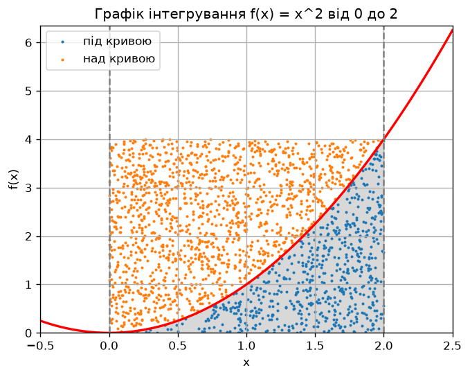

# goit-algo-hw-10

Домашнє завдання 10: жадібні алгоритми, динамічне програмування та метод Монте-Карло.

## Запуск

```bash
pip install -r requirements.txt
python task1.py
python task2.py            # з вікном графіка
python task2.py --no-show  # лише зберегти графік у monte_carlo.png
```

## Завдання 1. Видача решти

Номінали: `[50, 25, 10, 5, 2, 1]`.

- `find_coins_greedy(amount)` — жадібний алгоритм. Перебирає номінали від найбільшого до найменшого і бере кожного стільки, скільки вміщується в залишок (`divmod`).
- `find_min_coins(amount)` — динамічне програмування. Будує масив `min_coins[s]` (мінімальна кількість монет для суми `s`) для всіх сум від 0 до `amount`, а потім відновлює набір монет через масив `last_coin`.

Результат для суми 113:

```
Жадібний алгоритм:        {50: 2, 10: 1, 2: 1, 1: 1}
Динамічне програмування:  {1: 1, 2: 1, 10: 1, 50: 2}
```

### Складність

| Алгоритм | Час | Пам'ять |
|---|---|---|
| Жадібний | O(k) | O(k) |
| Динамічне програмування | O(n · k) | O(n) |

Тут `n` — сума, `k` — кількість номіналів (6). Жадібний алгоритм рахує кількість монет кожного номіналу діленням, тому його час не залежить від суми. Алгоритм ДП заповнює таблицю з `n + 1` клітинок і для кожної перебирає всі `k` номіналів.

### Вимірювання часу

Середній час одного виклику (`timeit`, Python 3.14):

| Сума | Жадібний, с | ДП, с | ДП повільніший у | Монет (жадібний / ДП) |
|---:|---:|---:|---:|---:|
| 113 | 1.03e-06 | 9.52e-05 | 93 рази | 5 / 5 |
| 1 000 | 1.20e-06 | 8.17e-04 | 679 разів | 20 / 20 |
| 10 000 | 1.33e-06 | 9.08e-03 | 6 832 рази | 200 / 200 |
| 100 000 | 1.37e-06 | 1.07e-01 | 78 018 разів | 2 000 / 2 000 |
| 1 000 000 | 1.32e-06 | 1.11e+00 | 840 452 рази | 20 000 / 20 000 |

Точні числа залежать від комп'ютера, але тенденція стабільна:

- Час жадібного алгоритму майже не змінюється: близько 1 мкс для будь-якої суми.
- Час ДП росте лінійно із сумою: сума у 10 разів більша — час теж приблизно у 10 разів більший. Для суми 1 000 000 це вже понад секунда і мільйон елементів у пам'яті.
- Обидва алгоритми дають однакову кількість монет для всіх перевірених сум.

### Висновки

1. Для номіналів `[50, 25, 10, 5, 2, 1]` жадібний алгоритм завжди дає оптимальний результат. Така система номіналів називається канонічною. Тому для цього касового апарата найкраще підходить жадібний алгоритм: результат той самий, а працює він швидше на кілька порядків і майже не використовує пам'яті.
2. Динамічне програмування погано масштабується на великі суми. Час O(n · k) і пам'ять O(n) залежать від величини суми, а не від кількості номіналів. Для суми 10⁶ потрібна таблиця з мільйона елементів, для 10⁹ алгоритм стає непридатним на практиці.
3. Перевага ДП — гарантія оптимуму для будь-якого набору номіналів. Жадібний алгоритм може помилитися на неканонічних номіналах. Приклад із `task1.py`: номінали `[4, 3, 1]`, сума 6. Жадібний алгоритм дає `4 + 1 + 1` (3 монети), а ДП дає `3 + 3` (2 монети). Якщо в касі з'явиться нестандартний номінал або обмежена кількість монет, слід обирати ДП (або перевірити, що система номіналів канонічна).
4. ДП також доцільне, коли треба відповідати на багато запитів для різних сум до деякого максимуму: таблицю можна побудувати один раз і далі читати відповіді з неї.

## Завдання 2. Інтеграл методом Монте-Карло

Функція `f(x) = x²` на відрізку `[0, 2]`. Точне значення: ∫₀² x² dx = x³/3 |₀² = 8/3 ≈ 2.6666666667.

У `task2.py` реалізовано два варіанти методу Монте-Карло:

- **Метод «влучань» (hit-or-miss).** Генеруємо N випадкових точок у прямокутнику `[0, 2] × [0, 4]`. Інтеграл ≈ площа прямокутника × частка точок під кривою. Саме цей підхід показано на графіку (сіра зона — шукана площа).
- **Метод середнього значення.** Генеруємо N випадкових `x` на `[0, 2]`. Інтеграл ≈ `(b − a) · середнє f(x)`.



### Порівняння з аналітичним розв'язком і `quad`

```
Аналітично:  2.6666666667
quad:        2.6666666667 (оцінка похибки 3.0e-14)
```

Один запуск (seed = 42), відносна похибка щодо `quad`:

| N | Влучання | Похибка | Середнє значення | Похибка |
|---:|---:|---:|---:|---:|
| 100 | 2.720000 | 2.000% | 2.528546 | 5.180% |
| 1 000 | 2.608000 | 2.200% | 2.625574 | 1.541% |
| 10 000 | 2.600000 | 2.500% | 2.660454 | 0.233% |
| 100 000 | 2.672720 | 0.227% | 2.658191 | 0.318% |
| 1 000 000 | 2.664952 | 0.064% | 2.664578 | 0.078% |
| 10 000 000 | 2.665832 | 0.031% | 2.666620 | 0.002% |

Окремий запуск залежить від випадку, тому похибку також усереднено за 100 запусків:

| N | Влучання | Середнє значення |
|---:|---:|---:|
| 100 | 10.930% | 7.400% |
| 1 000 | 3.528% | 2.213% |
| 10 000 | 1.141% | 0.667% |
| 100 000 | 0.338% | 0.228% |

### Висновки

1. Метод Монте-Карло дає правильний результат. Оцінка наближається до точного значення 8/3, яке підтверджують і аналітичний розрахунок, і `scipy.integrate.quad`. Для N = 10⁶ похибка менша за 0.1%.
2. Похибка спадає як 1/√N. Щоб зменшити її в 10 разів, потрібно у 100 разів більше точок. Це видно з таблиці усереднених похибок: кожне збільшення N у 10 разів зменшує похибку приблизно у √10 ≈ 3.2 раза.
3. Результат випадковий. Один запуск з малою кількістю точок може дати помітне відхилення (для N = 100 — до кількох десятків відсотків), а більше N не гарантує меншої похибки в кожному окремому запуску (див. N = 1 000 і 10 000 в першій таблиці). Точність треба оцінювати статистично.
4. Метод середнього значення точніший за метод «влучань» при тій самій кількості точок, бо використовує саме значення функції, а не лише ознаку «під кривою чи ні».
5. Для одновимірного інтеграла від гладкої функції `quad` значно кращий: точність близько 10⁻¹⁴ за кілька десятків обчислень функції. Метод Монте-Карло корисний для багатовимірних інтегралів і складних областей, де детерміновані квадратурні методи стають надто дорогими, бо його швидкість збіжності 1/√N не залежить від розмірності.
